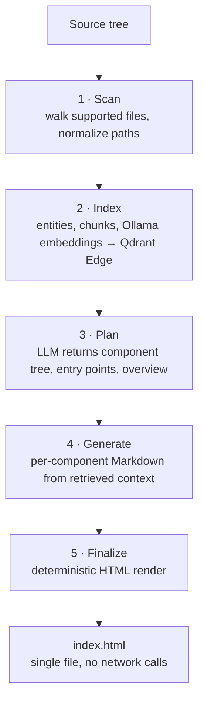

<p align="center">
  
</p>

<p align="center">
  <b>English</b> ·
  <a href="README.ru.md">Русский</a>
</p>

<p align="center">
  <a href="https://github.com/ksen145/DocCode/releases"></a>
  
  
  
  
  
</p>

<p align="center">
  <i>A local desktop app that turns a codebase into one self-contained, interactive HTML documentation site.</i>
</p>

---

**DocCode** scans your project, splits it into meaningful fragments, indexes them
in a local vector store, and asks a local LLM for documentation built strictly on
the retrieved context. The result is a **single `index.html`** — project overview,
component and file tree, search, and quality statuses, with no external
dependencies and no network requests.

> [!NOTE]
> Only relevant fragments are sent to the model, never the whole repository.
> All requests go to the Ollama endpoint you configure — by default a local
> server, so your sources never leave the machine.

## Features

| | Capability | What you get |
| --- | --- | --- |
| 🔍 | **Multi-language analysis** | Python, Rust, JavaScript, TypeScript, HTML and CSS parsed with tree-sitter |
| 🧠 | **Vector code index** | Qdrant Edge embedded (no separate server) or an in-memory fallback |
| ✍️ | **LLM-written docs** | A component plan plus per-component Markdown grounded in retrieved context |
| 🧩 | **Configurable reasoning** | Enable or disable model `think`; reasoning traces are stripped before Markdown becomes HTML |
| ✅ | **D1 quality gate** | Factual accuracy and completeness scored by a model, with configurable thresholds and retries |
| 📦 | **One output file** | `index.html` with overview, entry points, component tree, search, breadcrumbs and hash routes |
| 🎨 | **Light and dark themes** | Theme follows the OS by default; an explicit choice is persisted |
| 🌐 | **Bilingual UI** | Russian and English interface; the language also drives the docs language |
| 💻 | **Native UX** | Project and documentation folders picked with the system dialog, launch to VS Code from code blocks |

## How it works



1. **Scan** — walk files of supported languages and normalize paths.
2. **Index** — extract entities, build chunks, embed them through Ollama, store vectors in Qdrant Edge.
3. **Plan** — the LLM receives the file list and a vector selection, and returns JSON with the component tree, entry points and a project overview.
4. **Generate** — for each component the LLM writes Markdown from a strict template; D1 checks facts and completeness.
5. **Finalize** — deterministic render of `index.html`.

D1 is a separate Ollama model (`/v1/systemone`) that answers typed questions about a
document. The check can be disabled in project settings; documents below the
threshold are marked `needs_review` instead of failing the run.

## What the generated site includes

| Section | Details |
| --- | --- |
| **Overview** | Project summary and entry points |
| **Structure** | Component hierarchy and file tree |
| **Search** | Across components, files and entities |
| **Navigation** | Breadcrumbs and hash routes, copyable `path:line`, jump to VS Code |
| **Quality** | D1 badges and a quality table |
| **Theming** | Light and dark themes, choice persisted |

## Requirements

- Rust stable (edition 2021) — only if you build from source.
- Windows 10/11 or Linux with a graphical environment; macOS has not been tested separately.
- A running [Ollama](https://ollama.com/) instance with the models pulled.

| Model | Purpose | Required |
| --- | --- | --- |
| `gemma4:e4b` | Documentation generation | Yes |
| `nomic-embed-text` | Embeddings for the vector index | Yes |
| `d1` | Quality control | No |

```bash
ollama pull gemma4:e4b
ollama pull nomic-embed-text
ollama pull d1
```

If the D1 model is missing, disable the check in settings — generated docs are then
marked as unverified.

## Quick start

**Prebuilt packages** are published on the [Releases](https://github.com/ksen145/DocCode/releases)
page: a Windows installer and `.deb`/AppImage builds for Linux.

Build and run from source:

```bash
cargo run --release
```

Release builds on Windows start without a console window; debug builds keep the
console for logs.

In the app:

1. Pick the project root and the documentation folder with the system dialog
   (default is `docs/` inside the project).
2. Configure Ollama: URL, generation model, embeddings model and D1 model.
3. Optionally adjust `temperature`, `max_tokens`, the `think` reasoning toggle,
   D1 thresholds and retry count.
4. Press **Generate** and follow the stages:
   **Scan → Index → Plan → Generate → Finalize**.
5. Open the produced `index.html`.

<details>
<summary><b>Lightweight build without Qdrant</b></summary>

Uses the in-memory vector store — handy for smoke tests and debugging:

```bash
cargo run --no-default-features
```

</details>

## Examples

| Command | What it does |
| --- | --- |
| `cargo run --example ollama_smoke -- http://localhost:11434 gemma4:e4b` | Check connectivity to Ollama |
| `cargo run --example analyze_project -- .` | Analyse a project without an LLM |
| `cargo run --example render_site_demo -- ./demo-site` | Render a demo site without an LLM (layout and JS) |
| `cargo run --example site_e2e -- <project> gemma4:e4b <docs>` | Full pipeline without the GUI |

<details>
<summary><b>Running without the D1 check</b></summary>

```bash
DOCCODE_D1=0 cargo run --example site_e2e -- <project>
```

On Windows:

```powershell
$env:DOCCODE_D1 = "0"
cargo run --example site_e2e -- <project>
```

</details>

## Data locations

| What | Where |
| --- | --- |
| Configuration | `config.toml` in the system config directory (`%APPDATA%\doccode` on Windows, `~/.config/doccode` on Linux) |
| Prompts | `prompts.yaml` next to the config; built-in prompts are used when absent |
| Vector index | system cache directory, `doccode/projects/<hash>/index` |
| Result | the chosen folder, `index.html` |

The index is rebuilt on every run. Source code and results are never uploaded:
network requests go only to the configured Ollama address.

## Build and test

```bash
cargo fmt --all --check
cargo check --all-targets
cargo test
cargo test --no-default-features
```

## Project layout

```text
src/
├── ai/           # Ollama client, D1 contract, AiClient abstraction
├── app/          # GUI state and pipeline stages
├── core/         # scanner, tree-sitter parsers, project model
├── docs/         # chunks and retrieval, plan, generation, HTML render
├── index/        # Qdrant Edge and in-memory vector stores
├── prompts/      # YAML schema, templates, variable substitution
├── ui/           # iced screens, theme, i18n
├── config.rs     # application configuration
├── lib.rs
└── main.rs

assets/           # README banner
locales/          # ru/en UI translations
packaging/        # icons, NSIS installer, deb/AppImage, Docker
examples/         # runnable examples
tests/            # integration tests
prompts.yaml      # built-in prompts (overridden by a user file)
```

## Limitations

- Only Ollama is supported; other OpenAI-compatible backends are not wired up yet.
- Embeddings are computed sequentially, so indexing large projects takes noticeable time.
- There is no incremental index update: the index is rebuilt in full.
- D1 is a conservative filter: `needs_review` means manual review is advised, not that generation failed.
- The generated site shell is currently localized in Russian; the selected language affects the documentation language.
- macOS is not verified.

## Code signing policy

Windows releases are signed with a certificate from SignPath Foundation —
free code signing provided by [SignPath.io](https://about.signpath.io),
certificate by [SignPath Foundation](https://signpath.org).

What is signed, how requests are approved and how to verify a download:
[**CODE_SIGNING_POLICY.md**](CODE_SIGNING_POLICY.md).

## Packaging

Icons, the Windows installer and Linux packages are built by the scripts in
[`packaging/`](packaging/): `build-release.ps1` runs everything, `windows/`
holds the NSIS installer, `linux/` builds .deb/AppImage in Docker.

The version lives in one place — `version` in `Cargo.toml`. Bump it with
`packaging/bump-version.ps1` (it also syncs `Cargo.lock`), then tag `vX.Y.Z`:

```powershell
powershell -File packaging\bump-version.ps1 0.2.0
git commit -am "release: 0.2.0"; git tag v0.2.0
```

```powershell
# everything at once: icons + Windows + Linux (Linux is built in Docker)
powershell -File packaging/build-release.ps1
```

## License

MIT — see [LICENSE](LICENSE).

---

<p align="center">
  <sub>Built with Rust · iced · tree-sitter · Qdrant Edge · Ollama</sub>
</p>

<p align="center">
  <a href="README.md">English</a> ·
  <a href="README.ru.md">Русский</a>
</p>
