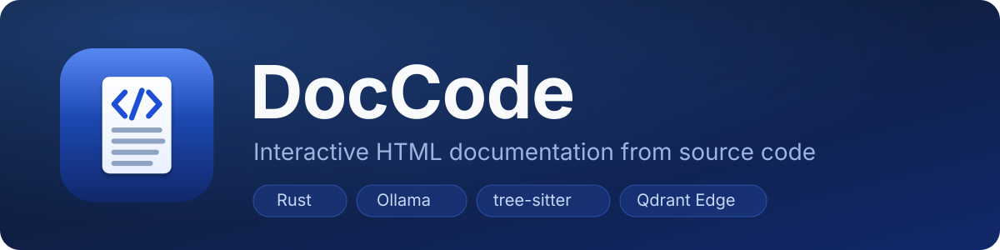
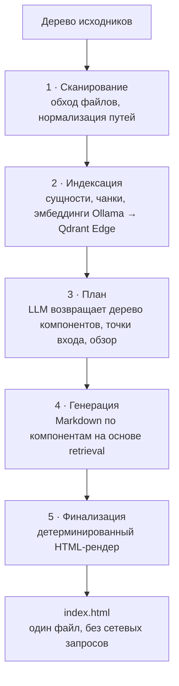

<p align="center">
  
</p>

<p align="center">
  <a href="README.md">English</a> ·
  <b>Русский</b>
</p>

<p align="center">
  <a href="https://github.com/ksen145/DocCode/releases"></a>
  
  
  
  
  
</p>

<p align="center">
  <i>Локальное десктопное приложение, которое превращает проект в один самодостаточный интерактивный HTML-сайт документации.</i>
</p>

---

**DocCode** сканирует проект, режет его на смысловые фрагменты, индексирует их в
локальной векторной базе и просит локальную LLM написать документацию строго по
найденному контексту. На выходе — **один `index.html`**: обзор проекта, дерево
компонентов и файлов, поиск и статусы проверки качества, без внешних
зависимостей и сетевых запросов.

> [!NOTE]
> В модель отправляются только релевантные фрагменты, а не весь репозиторий.
> Все запросы идут на указанный адрес Ollama — по умолчанию локальный сервер,
> поэтому исходники не покидают машину.

## Возможности

| | Возможность | Что получаете |
| --- | --- | --- |
| 🔍 | **Анализ нескольких языков** | Python, Rust, JavaScript, TypeScript, HTML и CSS через tree-sitter |
| 🧠 | **Векторный индекс кода** | Встроенный Qdrant Edge (без отдельного сервера) или in-memory fallback |
| ✍️ | **Документация от LLM** | План компонентов и Markdown по каждому компоненту на основе векторного контекста |
| ✅ | **Контроль качества D1** | Фактическая точность и полнота от модели, настраиваемые пороги и повторы |
| 📦 | **Один файл на выходе** | `index.html` с обзором, точками входа, деревом компонентов, поиском, хлебными крошками и hash-маршрутами |
| 🎨 | **Светлая и тёмная темы** | Тема следует за ОС; явный выбор сохраняется |
| 🌐 | **Двуязычный интерфейс** | Русский и английский; язык влияет и на язык документации |
| 💻 | **Нативный UX** | Папки выбираются через системный диалог, из блоков кода можно перейти в VS Code |

## Как это работает



1. **Сканирование** — обход файлов поддерживаемых языков, нормализация путей.
2. **Индексация** — извлечение сущностей, чанки, эмбеддинги Ollama и запись векторов в Qdrant Edge.
3. **План** — LLM получает список файлов и векторную выборку и возвращает JSON с деревом компонентов, точками входа и общим обзором.
4. **Генерация** — для каждого компонента LLM пишет Markdown по строгому шаблону; D1 проверяет факты и полноту.
5. **Финализация** — детерминированный рендер `index.html`.

D1 — отдельная модель Ollama (`/v1/systemone`), которая отвечает на типизированные
вопросы о документе. Проверку можно отключить в настройках проекта; не прошедшие
порог документы помечаются `needs_review`, а не считаются ошибкой.

## Что внутри сгенерированного сайта

| Раздел | Детали |
| --- | --- |
| **Обзор** | Краткое описание проекта и точки входа |
| **Структура** | Иерархия компонентов и дерево файлов |
| **Поиск** | По компонентам, файлам и сущностям |
| **Навигация** | Хлебные крошки и hash-маршруты, копирование `path:line`, переход в VS Code |
| **Качество** | Бейджи и таблица качества D1 |
| **Темы** | Светлая и тёмная, выбор сохраняется |

## Требования

- Rust stable (edition 2021) — только для сборки из исходников.
- Windows 10/11 или Linux с графической средой; macOS отдельно не проверялся.
- Запущенный [Ollama](https://ollama.com/) с загруженными моделями.

| Модель | Назначение | Обязательна |
| --- | --- | --- |
| `gemma4:e4b` | Генерация документации | Да |
| `nomic-embed-text` | Эмбеддинги для векторного индекса | Да |
| `d1` | Контроль качества | Нет |

```bash
ollama pull gemma4:e4b
ollama pull nomic-embed-text
ollama pull d1
```

Если модели D1 нет, отключите проверку в настройках — документация будет помечена
как непроверенная.

## Быстрый старт

**Готовые сборки** публикуются на странице [Releases](https://github.com/ksen145/DocCode/releases):
установщик для Windows и `.deb`/AppImage для Linux.

Сборка и запуск из исходников:

```bash
cargo run --release
```

Release-сборка для Windows запускается без консольного окна; в debug-режиме
консоль остаётся для логов.

В приложении:

1. Выберите корень проекта и папку для документации через системный диалог
   (по умолчанию — `docs/` внутри проекта).
2. Настройте Ollama: URL, модель генерации, модель эмбеддингов и модель D1.
3. При необходимости измените `temperature`, `max_tokens`, пороги D1 и число повторов.
4. Нажмите **«Сгенерировать»** и дождитесь стадий
   **Сканирование → Индексация → План → Генерация → Финализация**.
5. Откройте созданный `index.html`.

<details>
<summary><b>Лёгкая сборка без Qdrant</b></summary>

Используется in-memory векторное хранилище — удобно для проверки и отладки:

```bash
cargo run --no-default-features
```

</details>

## Примеры

| Команда | Что делает |
| --- | --- |
| `cargo run --example ollama_smoke -- http://localhost:11434 gemma4:e4b` | Проверка связи с Ollama |
| `cargo run --example analyze_project -- .` | Анализ проекта без LLM |
| `cargo run --example render_site_demo -- ./demo-site` | Демонстрационный сайт без LLM (вёрстка и JS) |
| `cargo run --example site_e2e -- <проект> gemma4:e4b <docs>` | Полный прогон пайплайна без GUI |

<details>
<summary><b>Запуск без проверки D1</b></summary>

```bash
DOCCODE_D1=0 cargo run --example site_e2e -- <проект>
```

На Windows:

```powershell
$env:DOCCODE_D1 = "0"
cargo run --example site_e2e -- <проект>
```

</details>

## Где хранятся данные

| Что | Где |
| --- | --- |
| Конфигурация | `config.toml` в системном каталоге конфигурации (`%APPDATA%\doccode` на Windows, `~/.config/doccode` на Linux) |
| Промпты | `prompts.yaml` рядом с конфигурацией; при отсутствии используются встроенные |
| Векторный индекс | системный cache-каталог, `doccode/projects/<hash>/index` |
| Результат | выбранная папка, файл `index.html` |

Индекс пересобирается при каждом запуске. Исходный код и результаты не
загружаются в облако: сетевые запросы идут только на указанный адрес Ollama.

## Сборка и тесты

```bash
cargo fmt --all --check
cargo check --all-targets
cargo test
cargo test --no-default-features
```

## Структура проекта

```text
src/
├── ai/           # Ollama-клиент, контракт D1, абстракция AiClient
├── app/          # состояние GUI и стадии пайплайна
├── core/         # сканер, tree-sitter парсеры, модель проекта
├── docs/         # чанки и retrieval, план, генерация, HTML-рендер
├── index/        # Qdrant Edge и in-memory векторное хранилище
├── prompts/      # YAML-схема, шаблоны и подстановка переменных
├── ui/           # экраны iced, тема, i18n
├── config.rs     # конфигурация приложения
├── lib.rs
└── main.rs

assets/           # баннер для README
locales/          # ru/en переводы интерфейса
packaging/        # иконки, NSIS-установщик, deb/AppImage, Docker
examples/         # запускаемые примеры
tests/            # интеграционные тесты
prompts.yaml      # встроенные промпты (переопределяются пользовательским файлом)
```

## Ограничения

- Поддерживается только Ollama; другие OpenAI-совместимые бэкенды пока не подключены.
- Эмбеддинги считаются последовательно — на больших проектах индексация занимает заметное время.
- Инкрементального обновления индекса нет: он пересобирается целиком.
- D1 — консервативный фильтр: `needs_review` означает необходимость ручной проверки, а не сбой генерации.
- Оболочка сгенерированного сайта пока локализована на русский; выбранный язык влияет на язык документации.
- macOS не проверялся.

## Code signing policy — политика подписи кода

Windows-релизы собираются из исходников на GitHub-hosted раннерах и
подписываются через [SignPath.io](https://about.signpath.io); сертификат выдан
[SignPath Foundation](https://signpath.org). Приватный ключ не покидает SignPath,
секретов подписи в репозитории нет.

Free code signing provided by [SignPath.io](https://about.signpath.io), certificate by [SignPath Foundation](https://signpath.org).

- Коммиттеры и ревьюеры: [@ksen145](https://github.com/ksen145)
- Утверждающие релизы: [@ksen145](https://github.com/ksen145)

Каждый релиз собирается workflow [`Release`](.github/workflows/release.yml) из
помеченного коммита и подтверждается вручную перед подписью. Политика и
конфигурации артефактов лежат в [`packaging/windows/signpath/`](packaging/windows/signpath/).

Политика приватности: DocCode работает полностью локально и ничего никуда не
отправляет, кроме настроенного пользователем Ollama — см.
[Где хранятся данные](#где-хранятся-данные).

## Упаковка

Иконки, установщик Windows и пакеты Linux собирают скрипты в
[`packaging/`](packaging/): `build-release.ps1` запускает всё сразу, `windows/` —
NSIS-установщик, `linux/` — .deb/AppImage в Docker.

Версия живёт в одном месте — `version` в `Cargo.toml`. Меняется через
`packaging/bump-version.ps1` (заодно синхронизирует `Cargo.lock`), затем тег `vX.Y.Z`:

```powershell
powershell -File packaging\bump-version.ps1 0.2.0
git commit -am "release: 0.2.0"; git tag v0.2.0
```

```powershell
# всё сразу: иконки + Windows + Linux (Linux собирается в Docker)
powershell -File packaging/build-release.ps1
```

## Лицензия

MIT — см. [LICENSE](LICENSE).

---

<p align="center">
  <sub>Сделано на Rust · iced · tree-sitter · Qdrant Edge · Ollama</sub>
</p>

<p align="center">
  <a href="README.md">English</a> ·
  <a href="README.ru.md">Русский</a>
</p>
